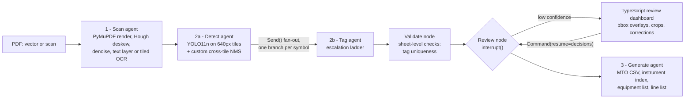
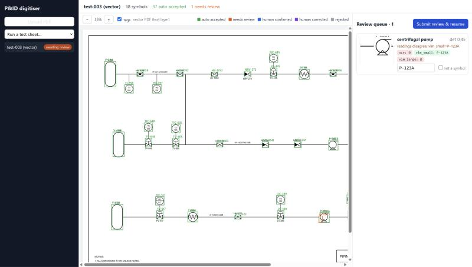
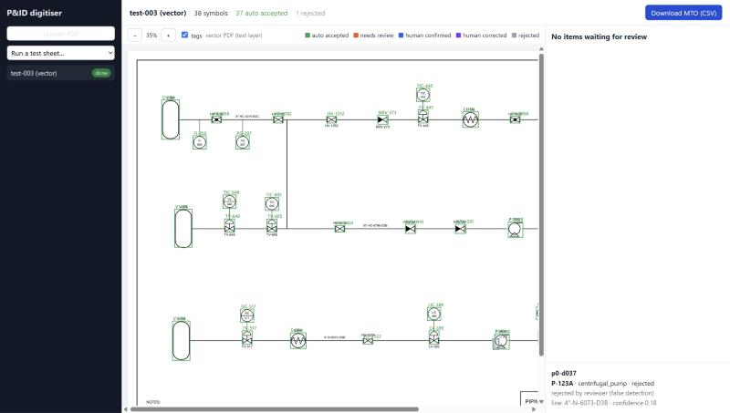

# P&ID Digitiser: hybrid vision + local VLM pipeline with human review

Turns a P&ID drawing (vector PDF or a bad scan) into structured, validated data:
symbols, instrument/equipment/valve tags, pipe line numbers and a valve
material take-off (MTO). It runs fully offline on one laptop GPU, and it
checks its own work: a reading is auto-accepted only when deterministic checks
pass. Everything else goes to a human review queue.



## Why it is built this way

| Requirement in document AI | How this repo handles it |
|---|---|
| Real drawings are huge, symbols are tiny | 3300 x 2300 px pages are cut into overlapping 640 px tiles; detections are merged with class-aware NMS that also uses intersection-over-smaller, so a valve cut by a tile edge doesn't survive next to its full copy (`pid/detect.py`) |
| Scans are skewed and noisy | Skew is measured from long pipe lines with probabilistic Hough (length-weighted median), then median-filtered and contrast-stretched (`pid/scan.py`) |
| CAD exports already contain the text | Hybrid text path: vector PDFs are read from the PDF text layer (exact, confidence 1.0); only rasters go through OCR |
| Small models fail quietly | Every agent boundary is a Pydantic contract (`pid/schemas.py`). VLMs are called with Ollama's `format=<JSON schema>` (constrained decoding) and the output is validated again |
| "The LLM said so" is not evidence | Per-class tag grammar (regex), calibrated OCR threshold, and a VLM answer is only accepted when it agrees with an independent source |
| Compute cost | Per-agent escalation ladder: text layer -> OCR -> `qwen3-vl:2b` -> `qwen3-vl:4b` -> human. Expensive rungs only run when cheaper ones fail a check |
| Long jobs and human pauses | LangGraph with a SQLite checkpointer; `interrupt()` pauses a run for review, which survives a server restart and resumes with `Command(resume=...)` |
| On-prem / privacy | Everything is local: YOLO on the GPU, RapidOCR (ONNX) on CPU, VLMs through Ollama (Q4 quantised GGUF). No API keys |

## The escalation ladder (`pid/read_tags.py`)

| Rung | Auto-accept rule |
|---|---|
| PDF text layer | tag passes the class grammar |
| OCR (RapidOCR) | passes grammar **and** OCR score >= calibrated threshold |
| `qwen3-vl:2b` | valid **and** (equals the OCR reading, **or** keeps every character OCR read and only fills letters OCR dropped) |
| `qwen3-vl:4b` | valid **and** agrees with the small VLM or OCR, or fills OCR gaps as above |
| Human | everything else, with the reason and every rung's answer shown in the dashboard |

A single VLM answer never auto-accepts on its own.

## Results (held-out sheets, measured against ground truth)

`python -m evals.run_eval --start 15 --name heldout`. The run uses 15 test sheets that were never looked at
while building or tuning the pipeline (sheets 0-14 were used for error analysis, see below).
Each run stops at the human-review interrupt, so these numbers are what the system decides **on its own**.

| metric | vector PDF | degraded scan |
|---|---|---|
| symbol detection recall (9 classes) | 1.000 | 1.000 |
| symbol detection precision | 0.986 | 0.979 |
| deskew error, mean | - | 0.031 deg |
| **precision of auto-accepted tags** | **549 / 549 (100%)** | **536 / 537 (99.8%)** |
| automation rate (no human needed) | 98.2% | 95.4% |
| sent to human review | 1.8% | 4.6% |
| ...accepted by text layer / OCR | 549 / 0 | 0 / 523 |
| ...accepted by `qwen3-vl:2b` / `qwen3-vl:4b` (all correct) | 0 / 0 | 4 / 10 |
| valve linked to the right line number | 100% | 91.4% |
| sheets whose valve MTO is exactly right | 15 / 15 | 11 / 15 |
| time per sheet (RTX 4060 laptop) | 14 s | 63 s |

YOLO11n on 640 px tiles: val mAP50 0.9996, mAP50-95 0.997 (synthetic tiles, 12 epochs).
OCR auto-accept threshold calibrated on the val split: **0.83** gives 99.65% precision on 573 readings
while accepting 97.4% of grammar-valid reads (`evals/CALIBRATION.md`).

### Failure modes found, and what changed because of them

| Found on | Failure | Fix (all deterministic) |
|---|---|---|
| dev sheets | YOLO split one valve into two overlapping boxes where a branch pipe touches it; both read the same tag, so the MTO counted it twice | NMS merges same-class fragments into their union (IoS > 0.3), plus a sheet-level `validate` node: a tag claimed by two symbols goes to review |
| dev sheets | 96% detection precision: slivers cut by tile edges were labelled as *another* class, so class-aware NMS never compared them | Cross-class pass: a box mostly inside a more confident box of another class is dropped (symbols never overlap on a P&ID). Dev-set precision 0.960 -> 0.993, recall unchanged |
| dev sheets | OCR read `LIC-932` as `LUC-932` (score 0.85) and the loose `[A-Z]{2,3}` grammar accepted it | Instrument grammar is now ISA 5.1: measured variable + function letters |
| dev sheets | Line numbers lost to `D`->`0`, a dropped `I` (`IA`->`A`), inch mark read as a degree sign | Repair against the project's line-designation table (service codes, pipe classes): only a **unique** OCR-confusable match is accepted |
| probe | `qwen3-vl` ignores `think=False` in Ollama; reasoning consumed the 64-token budget and returned empty JSON | Budget raised; schema validation already rejected the empty output, so nothing wrong was accepted |
| probe | `qwen3-vl:2b` answered `P-123A` for a false detection: the **example from the prompt** | Covered by the agreement rule: a lone VLM answer is never accepted |
| dev review queue | On hard crops the VLMs changed digits (7 of 24 calls), ran out of tokens (10), or got letters wrong (3); `4b` was right on most crops where OCR dropped letters | Accept a VLM tag only if it equals OCR, or keeps every character OCR read and fills only dropped letters |
| **held-out** | OCR read `TE-909` as `TE-606` at **0.996** confidence: RapidOCR's 180 degree text-direction classifier flipped a symmetric number | Classifier disabled (pages are deskewed; P&ID text is never upside-down). Verified on that sheet. **The held-out numbers above are from before this fix** |

The first run on sheets 0-14 is kept in `evals/results_dev_v1.md` for comparison.

## Review dashboard

| Review queue: crop, every rung's answer, reason, correction | After review: run resumed, MTO exported |
|---|---|
|  |  |

The page viewer draws every detection as an SVG overlay in page-pixel coordinates (green auto-accepted,
orange needs review, blue/purple human-confirmed/corrected, grey rejected). Submitting the queue calls
`POST /api/runs/{id}/resume`, which resumes the paused LangGraph thread from its SQLite checkpoint.
The dashboard checks corrections against the same tag grammar as the backend before it lets you submit.

## Data

There is no public set of client P&IDs, so `pid/synth/generate.py` draws ISA 5.1-style
sheets with PyMuPDF (9 symbol classes: gate/globe/check/control valves, pump,
exchanger, vessel, field and panel instrument bubbles, plus line numbers in
`6"-P-1001-A1A` form, a title block and notes as distractors). Every sheet is saved
twice, as a vector PDF and as a degraded scan (up to 3 degree skew, blur, noise,
speckle, JPEG artefacts), with exact ground truth. Splits: 120 train / 30 val /
30 test sheets, all from separate random seeds.

**Limitations, stated plainly:** synthetic sheets are cleaner and more regular than
real client drawings (no overlapping callouts, hand mark-ups, or vendor-specific
symbol libraries), so these numbers are an upper bound. The next step is
calibrating on real drawings. Pipe connectivity (graph extraction) is not built yet.

## Run it

```bash
# Python 3.12, NVIDIA GPU
python -m venv .venv && .venv/Scripts/activate
pip install torch torchvision --index-url https://download.pytorch.org/whl/cu128
pip install -r requirements.txt
ollama pull qwen3-vl:2b && ollama pull qwen3-vl:4b

python -m pid.synth.generate --out data          # 180 sheets + YOLO tiles
python -m train.train_yolo --epochs 40           # -> models/pid_symbols.pt
python -m evals.calibrate                        # -> models/ladder.json
python -m evals.run_eval --start 15 --name heldout   # -> evals/results_heldout.md
pytest -q                                        # 28 tests of the deterministic checks, no GPU needed

# one PDF from the command line (included samples)
python -m pid.graph samples/pid_scanned.pdf --auto-confirm

# review dashboard
uvicorn pid.api:app --port 8000
cd dashboard && npm install && npm run dev       # http://localhost:5173
```

## Layout

```
pid/schemas.py       Pydantic data contracts + tag grammar + normalisation
pid/scan.py          stage 1: render, deskew, denoise, text layer / tiled OCR
pid/detect.py        stage 2a: tiled YOLO + cross-tile NMS
pid/read_tags.py     stage 2b: escalation ladder, VLM calls with JSON-schema output
pid/graph.py         LangGraph: checkpointing, Send fan-out, interrupt/resume
pid/export.py        stage 3: MTO, instrument index, equipment and line lists
pid/api.py           FastAPI backend for the dashboard
dashboard/           React + TypeScript review UI (page viewer, bbox overlays, queue)
pid/synth/           synthetic P&ID generator with ground truth
train/, evals/       YOLO training, threshold calibration, end-to-end evaluation
tests/               unit tests for every deterministic check
```
